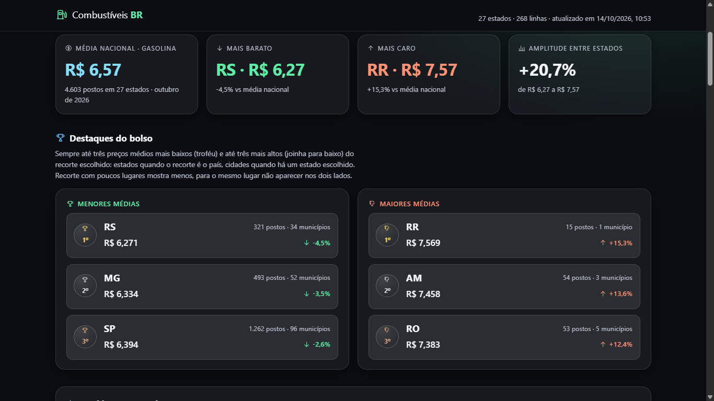
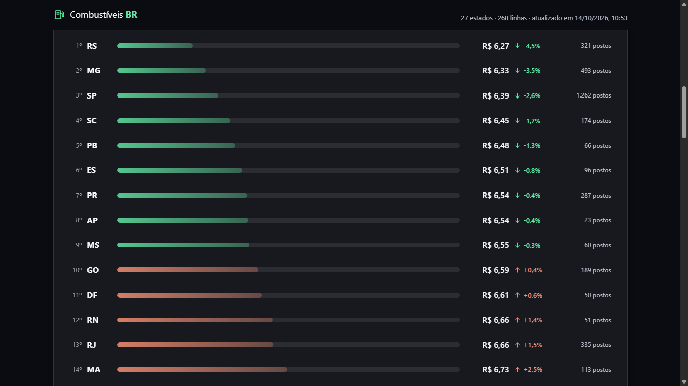
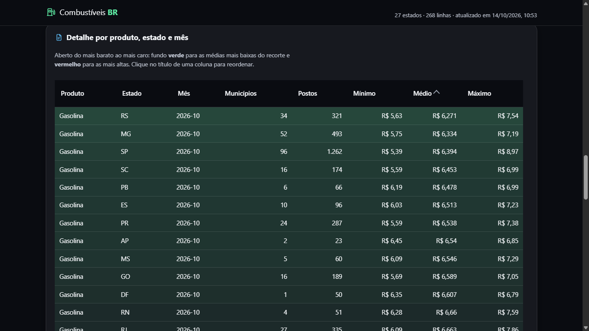
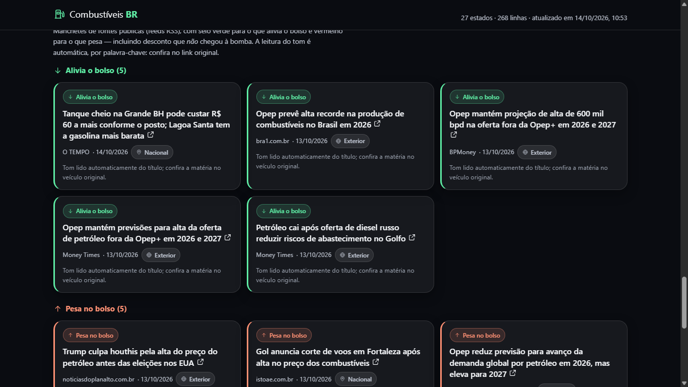
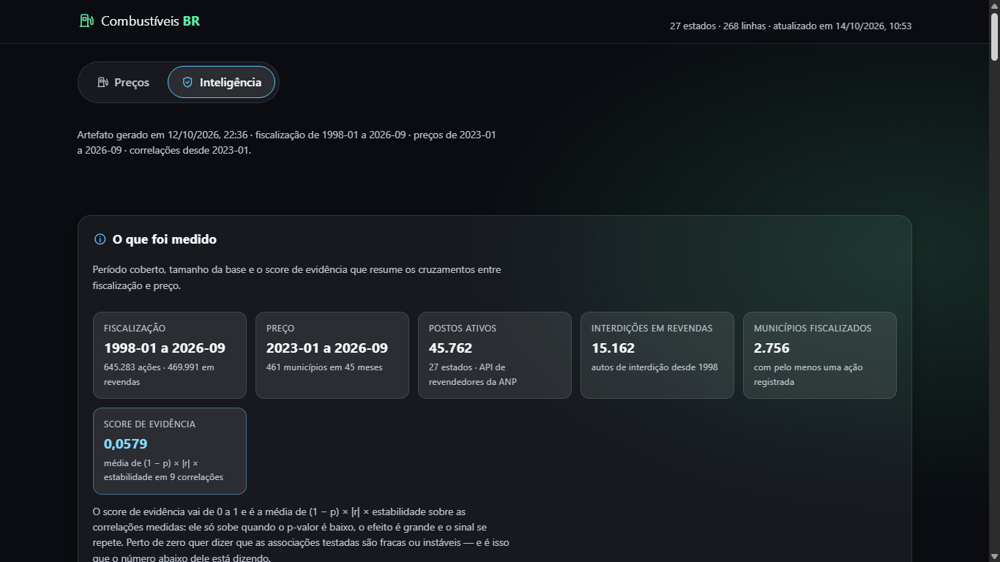

# combustivelBR

Preços de combustíveis no Brasil a partir de **dados públicos da ANP**, com um site estático que
qualquer um abre no navegador — inclusive sem internet.



O projeto faz três coisas:

1. **Coleta** o bruto publicado pela ANP e guarda intacto.
2. **Trata** esse bruto: valida, descarta o que não é preço por litro e resume por estado e por
   município.
3. **Publica** um único arquivo JSON que alimenta o site e, opcionalmente, uma API.

Nada de banco de dados, nada de framework no front, nada de etapa de build: o site é HTML, CSS e
JavaScript puros e lê o JSON por `fetch`.

## O que o site mostra

**Aba Preços** — o recorte do mês mais recente: média nacional, estado mais barato e mais caro,
amplitude, os três menores e os três maiores preços ("Destaques do bolso"), ranking com barra
proporcional, a tabela completa do mais barato ao mais caro e as manchetes do dia.

Escolha um **estado** e pressione **Pesquisar**: o painel desce ao nível da cidade — média estadual,
ranking e destaques por município.







**Aba Inteligência** — o preço cruzado com a fiscalização da ANP: correlações sempre com `r`, `p` e
`n`, IPF (intensidade de fiscalização por posto) por estado, municípios com preço mínimo colado na
média, alvos de fiscalização e as limitações do próprio artefato.



## Como rodar

Precisa de Windows com PowerShell e Python 3.10+ instalado.

```powershell
.\preparar.ps1               # cria o .venv e instala as dependências
.\pipeline.ps1 -Amostra      # gera o JSON a partir da amostra local (sem internet)
.\pipeline.ps1               # baixa o dado atual da ANP e publica
.\pipeline.ps1 -Uf SC        # estreita o recorte para um estado
.\pipeline.ps1 -Testes       # roda os testes antes de publicar
.\servir.ps1                 # site e API em http://127.0.0.1:8000
```

Não é preciso servidor para ver o site: abra `site\index.html` no navegador. O `servir.ps1` existe
para ver tudo junto e para consultar a API.

## Como o projeto funciona

```
ANP (dados abertos)
      |  coleta.py            baixa e guarda o bruto como veio
      v
data\raw\                     prova: nunca e editado, e nao entra no git
      |  transformacao.py     valida, corta e resume em dois degraus
      v
data\processed\dados.json --> site\data\dados.json --> site\ (HTML/CSS/JS)
                                     ^
                                     +-- servidor.py (FastAPI) serve o mesmo arquivo
```

O resumo é feito em **dois degraus**, e essa é a decisão mais importante do projeto:

- **revenda → município/mês**: cada revenda entra **uma vez** no mês, com a média das coletas dela.
  Sem isso, o posto pesquisado três vezes no mês valeria o triplo dos outros.
- **município → estado/mês**: média **ponderada** pelo número de postos. Média de médias daria o
  mesmo peso a um município com 40 postos e a outro com 400.

`postos_pesquisados` é a contagem de **revendas distintas**, não de coletas.

A segunda camada (fiscalização × preço) tem passos próprios, porque baixa outras fontes:

```powershell
$env:PYTHONPATH = "$PWD\src"
.\.venv\Scripts\python.exe scripts\inteligencia.py --baixar   # baixa o que falta, analisa e publica
.\.venv\Scripts\python.exe scripts\relatorio.py               # gera RELATORIO_INTELIGENCIA.md
.\.venv\Scripts\python.exe scripts\loop_noturno.py            # busca de parâmetros por evidência
```

## Fontes e condições de uso

Os dados são públicos e a fonte é sempre citada na tela e no próprio JSON (nome da fonte, endereço,
arquivo lido e data da coleta), junto da data de referência de cada número.

| Fonte | O que vem | Endereço |
|---|---|---|
| Levantamento de Preços | preço por revenda (uma linha por coleta) | [dados abertos da ANP](https://www.gov.br/anp/pt-br/centrais-de-conteudo/dados-abertos/serie-historica-de-precos-de-combustiveis) |
| Fiscalização do abastecimento | uma linha por procedimento, com UF e município | [painel dinâmico da fiscalização](https://www.gov.br/anp/pt-br/centrais-de-conteudo/paineis-dinamicos-da-anp/arquivos-dados-brutos-do-painel-dinamico-da-fiscalizacao-do-abastecimento-da-sfi/) |
| Revendedores | cadastro por CNPJ — é o denominador dos indicadores | `https://revendedoresapi.anp.gov.br/v1/combustivel` |
| Manchetes | título, veículo, data e link de veículos públicos | feeds RSS de Agência Brasil, Agência Gov, Senado e agregador |

- **Crédito à fonte**: os dados são da ANP; o tratamento, os resumos e os indicadores são deste
  projeto. Erro de cálculo ou de leitura é nosso, não da ANP.
- **O dado é informado pelas empresas** e pode ser retificado pela ANP; por isso cada número sai
  com o mês de referência e a data da coleta.
- **Interdição é dado preliminar**: o autuado tem contraditório e ampla defesa, e só o julgamento
  definitivo comprova a infração.
- **Nada de texto de terceiros**: das manchetes guardamos só título, veículo, data e link (Lei
  9.610/98, art. 46, III) — o texto é de quem publicou.

Código sob licença MIT. A base derivada (JSON, resumos e indicadores) é publicada sob **CC BY 4.0**,
com atribuição à ANP. O regime de uso da fonte, o que cumprimos e as ambiguidades que encontramos
estão registrados em **[docs/FONTES_E_USO.md](docs/FONTES_E_USO.md)**.

## Estrutura

```
src/combustivelbr/   o pacote: config, coleta, transformacao, noticias, servidor, cli
                     e a camada de analise: fiscalizacao, revendedores, historico, analise
scripts/             entrada dos passos: inteligencia, relatorio, loop_noturno
site/                HTML, CSS e JS estaticos + data\dados.json e data\inteligencia.json
data\raw\            bruto baixado (fora do git: e prova, nao fonte do site)
data\processed\      dados.json tratado
tests/               testes com pytest e fixtures pequenas, sem rede
docs/                ARQUITETURA.md (fluxo e contrato do JSON) e REGRAS_DE_OURO.md
```

Contrato do JSON, decisões e o porquê de cada corte: **[docs/ARQUITETURA.md](docs/ARQUITETURA.md)**.

## API (opcional)

Somente leitura, sobre os mesmos arquivos que o site lê:

`/saude` · `/dados` · `/inteligencia` · `/inteligencia/correlacoes` · `/inteligencia/ufs` ·
`/inteligencia/anomalias` · `/inteligencia/alvos` · `/inteligencia/interditos` ·
`/inteligencia/interdicao-preco`

## Testes

```powershell
.\.venv\Scripts\python.exe -m pytest
```

Os testes rodam sem rede e não tocam no dado real: usam as fixtures de `tests/fixtures/` e quadros
sintéticos. Mudou uma regra de negócio, mude o teste junto.

## Decisões que valem saber

- **GNV fica fora da média**: ele é vendido em R$/m³ e os demais em R$/litro — somar unidades
  diferentes mentiria. Gasolina aditivada tem linha própria, separada da comum.
- **Correlação nunca aparece sozinha**: sai com p-valor, tamanho de amostra e uma frase de leitura.
  Sem amostra mínima, o valor é `null` em vez de um número frágil.
- **Interdição × preço é medido contra controle**: o mesmo cálculo é feito nos demais municípios da
  mesma UF, nos mesmos meses. Sem isso o número mede a inflação do período, não o efeito da ação.
- **As limitações vão dentro do JSON**, junto do número, em vez de num arquivo à parte.
- **O tom da manchete é leitura automática por palavra-chave** e a tela avisa: é pista para o leitor
  conferir na fonte, não veredito.

## Autor

**George Herman Becker** — Gestão em Tecnologia da Informação

- **PIX:** `a8b68e14-edfe-4450-88f2-c2af4aca2a6c`
- **Buy Me a Coffee:** <https://buymeacoffee.com/georgehbecker>
- **LinkedIn:** <https://www.linkedin.com/in/georgehbecker/>

## Licença

MIT — veja [LICENSE](LICENSE).
